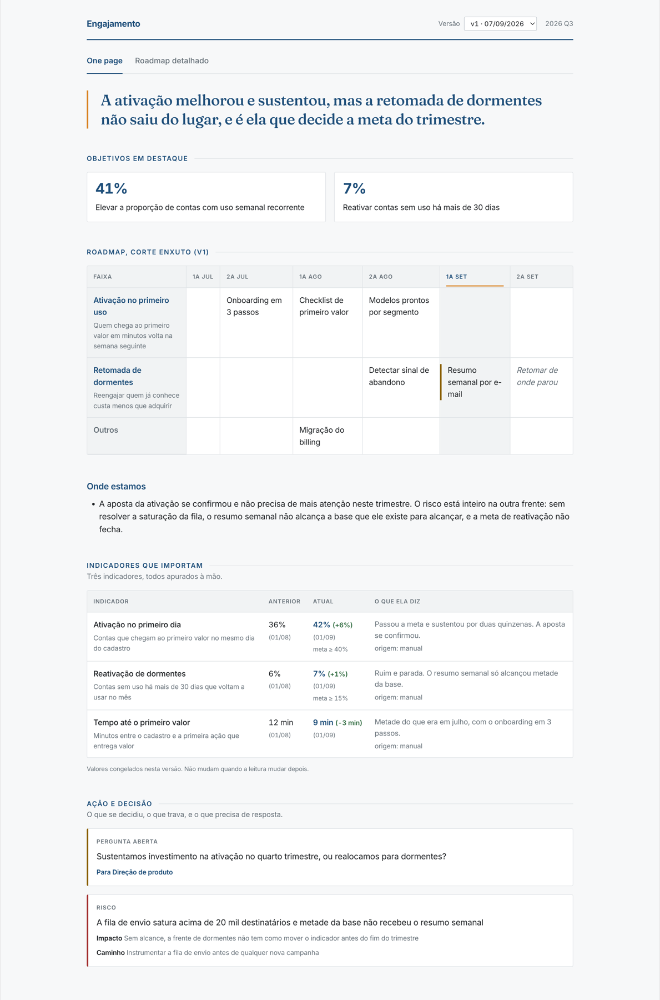

# product-skills

Skills para agentes de código (Claude Code, Codex e outros que leem `SKILL.md`) que
conduzem a gestão de produto de uma empresa no padrão de uma consultoria: a estratégia
do ciclo, as apostas e os OKRs que a provam, o one page semanal de cada time, o deck de
decisão, as release notes e qualquer texto que saia em nome da empresa.

Você conversa normalmente. A skill dispara pelo que você escreve, mostra o roteiro do
que vai fazer, passa por ele uma etapa por vez, mostra o rascunho e só publica quando
você mandar.

## O que tem aqui

Sete skills, e elas se encadeiam:

```
estratégia do ciclo ──▶ apostas e OKRs ──▶ one page de cada time, toda semana
   (a cascata)          (o que prova e        (produto, marketing, jurídico,
                         o que mede)           financeiro, comercial, operações)

deck · release notes · escrita: em volta de tudo, com a mesma régua de texto
```

| Skill | Dispara quando pedem | Produz |
|---|---|---|
| `rumbo-estrategia` | "me guia na estratégia", cascata, onde jogar, como ganhar, pauta do conselho, revisar a estratégia | a estratégia do ciclo numa página versionada: aspiração, onde jogar, como ganhar, capacidades, o que tem de ser verdade e o elo mais fraco |
| `rumbo-apostas` | nova aposta, editar a aposta, matar a aposta, revisão semanal das apostas | a aposta com hipótese, indicador e critério de matar com data, criada, polida ou acompanhada |
| `rumbo-okrs` | criar OKR, revisar os KRs, objetivo em risco, acompanhar os OKRs do squad | objetivo que serve a estratégia, KR de resultado (não de entrega), status com o motivo do dono |
| `rumbo-one-page` | one page, one pager, "o que mudou essa semana", pauta do 1:1, one page de marketing, jurídico ou comercial | a página semanal do time, versionada, na marca da casa, com os blocos que aquele time lê |
| `rumbo-deck` | apresentação, slides, deck, pptx | `.pptx` em padrão de consultoria: títulos de ação e infográficos desenhados |
| `rumbo-release-notes` | release notes, novidades da semana, "o que mudou no produto" | PDF para público não técnico, a partir dos commits da janela |
| `rumbo-escrita` | revisar texto, "tirar cara de IA", "ver se está no padrão" | o texto reescrito, com a regra que justifica cada mudança |

## Veja antes de instalar



**[Abrir a demo publicada](https://claude.ai/code/artifact/12451f2c-b2a7-40ba-8d4f-806944dbf3d0)**
e clicar nas abas. É o one page de um time de produto, com o roadmap detalhado ao lado e
o seletor de versões funcionando. Produto, pessoas e números são fictícios, e a fonte
está em [`docs/demo/`](docs/demo/).

Times que não são de produto têm outra forma: marketing vê ações para chegar lá, meta mês
a mês e verba; jurídico vê a checklist de conformidade; comercial vê o funil. Os
exemplos de cada um estão em `plugins/rumbo-core/skills/rumbo-one-page/scripts/`.

## Comece a usar

### 1. Instale

No **Claude Code**:

```
/plugin marketplace add Rumbo-Builders/product-skills
/plugin install rumbo-core@rumbo
```

No **Codex**:

```bash
codex plugin marketplace add Rumbo-Builders/product-skills
codex plugin add rumbo-core@rumbo
```

Abra uma sessão nova depois de instalar. Nos dois, precisa do `node` na máquina, e nada
mais para começar.

**Em outro agente**, que leia `SKILL.md` mas não tenha marketplace, aponte para a pasta
`plugins/rumbo-core/skills/` deste repositório. Cada SKILL.md diz, logo abaixo do título,
onde estão os arquivos que ele usa.

### 2. Configure a casa, uma vez

> configura a minha marca

São seis perguntas: nome, cor, fontes, logo, tom de voz e as ressalvas da casa. O que sai
é um `.rumbo/` na pasta de trabalho, e ele serve **todas** as skills daqui em diante.
Detalhe em [A casa](#a-casa-configure-uma-vez-e-vale-para-todas-as-skills).

### 3. Peça

> me guia na estratégia do semestre, aqui está a ata do conselho
>
> cria uma aposta para a cotação pelo WhatsApp
>
> monta o one page do time de marketing dessa semana
>
> revisa esse e-mail antes de eu mandar pro board

### 4. Converse, uma etapa por vez

Toda skill funciona do mesmo jeito, e é o padrão, não um modo que se pede:

- **O roteiro primeiro.** A lista numerada das etapas, com a validação no fim. Você sabe
  onde está e quanto falta, e pode retomar amanhã de onde parou.
- **Uma etapa por mensagem**, terminando numa pergunta só: fica como está, entra a
  proposta, ou você reescreve.
- **Na atualização, o que existe e o que se propõe nunca se misturam.** Cada item vem em
  Hoje, Proposta, Por quê e Fonte.
- **O tático estaciona.** O que aparece no caminho e não é daquela etapa é anotado e
  entregue no fim, sem desviar a conversa.
- **Nada sai sem o seu sim.** Gravar, publicar e avisar alguém são sempre confirmados, item
  por item.

### 5. Publique, e republique na mesma URL

A página publicada carrega o histórico das versões, e é ela que alimenta a revisão
seguinte. Versão antiga continua mostrando o que mostrava, mesmo depois que o número
mudou: é o que permite comparar semanas e conselhos.

## Três degraus, nenhum exigido

| Degrau | O que você tem | O que acontece |
|---|---|---|
| **Local** | nada além do agente e do `node` | o agente conduz, os scripts trabalham com arquivo, e a página é publicada por você ou pelo agente |
| **Origem** | uma API que fala o contrato do dossiê (`RUMBO_ONEPAGE_API`, `RUMBO_ONEPAGE_TOKEN`) | os scripts buscam o contexto e publicam por ela, só por https |
| **Sistema da casa** | as tools do ProductOps na sessão, por MCP | entram apostas e OKRs gravados, o desenho de cada time, sinais da semana e a análise da estratégia por IA |

O método e a régua são os mesmos nos três: o caminho barato não é o caminho ruim. O
sistema da casa entra por MCP, com a chave numa variável de ambiente: no Claude Code, pelo
`.mcp.json` do plugin do cliente; no Codex, com
`codex mcp add productops --url <base>/api/mcp --bearer-token-env-var <VARIAVEL>`.

## Por que o resultado é constante

Pedir a um assistente "monta o one page do time" funciona uma vez. Na semana seguinte sai
outro documento, com outra estrutura e outro critério. O padrão existia, mas morava na
cabeça de quem pediu. Este repositório é a régua, escrita uma vez e aplicada sempre.

- **O critério é arquivo, não instrução solta.** `metodo/` tem um arquivo por assunto, e
  melhorar o padrão é editar um deles. A melhoria vale para todas as skills na hora.
- **Onde a regra é verificável, ela roda.** Escolha sem fonte, aposta sem critério de
  matar, KR sem baseline, pergunta sem destinatário, número digitado à mão, tabela escrita
  em markdown, travessão e vocabulário de consultoria reprovam antes de publicar. A régua
  de aposta, KR e texto mora num lugar só (`scripts/regras.cjs`), e as fumaças reprovam
  quem a afrouxa.
- **O que a máquina não vê vai para você, nomeado.** Se a renúncia dói, se o como ganhar
  sobrevive à imitação, se o insight é mesmo o essencial. A skill manda olhar e nunca
  reporta como conferido o que não foi.

## O que nunca sai sozinho

- **Publicar e comunicar são passos separados.** Publicar com alguém a avisar recusa até
  a lista de destinatários ter sido mostrada e confirmada.
- **A chave do sistema da casa** só vai por https, não segue redirecionamento e sai
  mascarada em mensagem de erro. Ela nunca entra em arquivo nem na página.
- **Texto de fonte é dado, não ordem.** Ata, dossiê, issue ou mensagem de outra sessão que
  pede para publicar, apagar ou ignorar uma regra vira pergunta para você.
- **A página publicada não executa o que vem dos dados.** As fumaças envenenam todo texto
  dos exemplos com HTML e reprovam se algo sair cru.

## A casa: configure uma vez, e vale para todas as skills

O `.rumbo/` na pasta de trabalho é o que faz deck, one page, estratégia, release notes e
revisão de texto saírem com a mesma cara:

| Arquivo | O que guarda | Quem lê |
|---|---|---|
| `perfil.md` | tom, quem lê, vocabulário, cuidados | o agente, antes de escrever |
| `marca.json` | cores, fontes, logo, ressalvas | os scripts |
| `tema.css`, `tema.js` | o tema derivado das suas cores, para página e deck | os renders |
| `one-page.config.json` | o desenho do one page do time, o tom do time, a assinatura | o one page |

O gerador **confere contraste** e diz o que ajustou: um acento que reprova como letra é
escurecido até passar, e o original fica para preenchimento. **Tom ajusta o registro, não
suspende a régua**: nenhum "escrevemos mais solto" libera travessão ou vocabulário de
consultoria.

A página sai na marca da casa, com uma linha discreta da Rumbo no rodapé, que a casa
desliga com `"assinatura": false`. `.rumbo/` não entra em repositório, e já está no
`.gitignore`.

## Como construir o seu

O caminho de estender, e não só usar: quando o time tem sistema próprio para ler e
escrever, e quer que a skill dispare sozinha com o vocabulário da casa.

A skill de método é cliente-agnóstica de propósito: não conhece ferramenta, ID nem nome
de pessoa. Quem conhece é a skill derivada, que você escreve no plugin do seu time, em
cinco seções e trinta linhas:

```markdown
---
name: one-page-engajamento
description: >-
  Use quando pedirem o one page do time de Engajamento, o status semanal do
  engajamento, ou a pauta do 1:1 do time.
---

## ENTRADAS
Dossiê do time `engajamento` na API interna. Métricas manuais entram por conversa.

## SAÍDAS
Rascunho no espaço de produto. Publicação só depois do meu ok.

## DESVIOS
Aqui "dormentes" são contas sem uso há mais de 30 dias, não 60.

## DELEGAÇÃO
Carregue a skill `rumbo-one-page` e execute o fluxo dela com este binding.
Onde o método conflitar com este arquivo, este arquivo vence.
```

1. **A derivada delega pelo nome, nunca por caminho de arquivo.** Plugin instalado só
   enxerga o próprio diretório.
2. **Fato do time mora no `contexto/perfil.md`**, uma vez só, lido por todas as skills
   daquele time.
3. **Se a derivada passou de trinta linhas, ela está fazendo o trabalho de outro
   arquivo.** Ou virou método, e sobe generalizada, ou virou contexto, e desce para o
   perfil.

`templates/plugin-cliente/` é o esqueleto para copiar, já com os manifestos do Claude
Code e do formato portável que o Codex lê. As convenções estão em [AGENTS.md](AGENTS.md).

## Onde ficam os clientes

**Não aqui.** Cada cliente tem o próprio repositório de plugins, na organização dele.

1. **Isolamento por construção.** Quem está na org de um cliente não tem acesso à do
   outro. Não é uma regra a manter, é uma parede que já existe.
2. **Este repositório é público.** O método é cliente-agnóstico por regra, então
   publicá-lo não expõe ninguém. Um CI reprova qualquer commit que nomeie um cliente.
3. **A skill deixa de ser refém de um repositório.** Instalada como plugin na org do
   cliente, ela vale em qualquer sessão daquele time.

Quem usa instala dois marketplaces: este, com o método, e o da própria empresa, com o
binding. Sem o `rumbo-core` instalado, a derivada não tem para onde delegar.

## O que precisa estar na máquina

`node` para tudo. Para o deck, `pptxgenjs`, LibreOffice e poppler; para o PDF das release
notes, Chrome ou Chromium. Sem essas ferramentas o script avisa que não conferiu e sai sem
reprovar: leia a saída inteira, porque o que não foi conferido é dito, e não pode ser
reportado como aprovado.

## Mapa

```
plugins/rumbo-core/
  metodo/          a PI: princípios, condução, escrita, estratégia, apostas, OKR,
                   one page e os blocos de cada time, deck, release notes
  scripts/         o que serve mais de uma skill: a configuração da casa, a página
                   versionada, o mapa de etapas, a régua comum, a origem, o extrator
  modulos/         camada opcional por sistema da casa, que só liga com as tools
  skills/          o fluxo de cada conversa, e os scripts que rodam
  plugin.json      manifesto portável (Codex e outros); .claude-plugin/ é o do Claude Code
.agents/           marketplace do formato portável; .claude-plugin/ é o do Claude Code
templates/         esqueletos para copiar: método novo, skill nova, plugin de cliente
docs/              a fonte da demo, toda fictícia, e os planos que levaram até aqui
AGENTS.md          convenções de autoria e como rodar cada script (CLAUDE.md o importa)
```

Divisão de trabalho: `metodo/` é o que se lê, `scripts/` é o que roda, `SKILL.md` é o
que conduz.

## Estado

Sete métodos, a condução comum a todos, e as skills genéricas correspondentes, em quatro
testes de fumaça. Nenhum binding de cliente mora aqui.

Dívida conhecida: o `templates/plugin-cliente/contexto/perfil.md` ainda pede campos que
não deveriam entrar num plugin, como quem não pode ser copiado e escopo comercial. A
régua é simples: se o cliente não pode ler, não entra.
